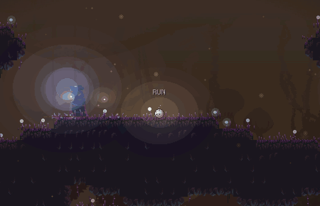
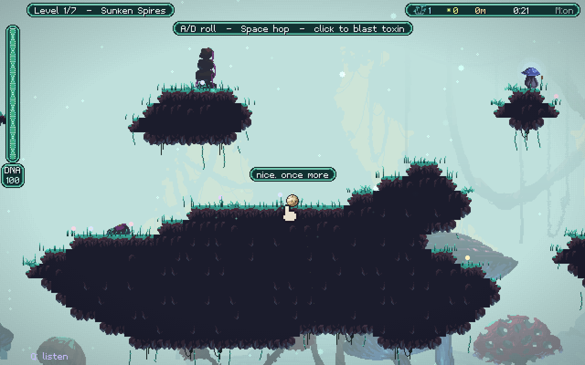
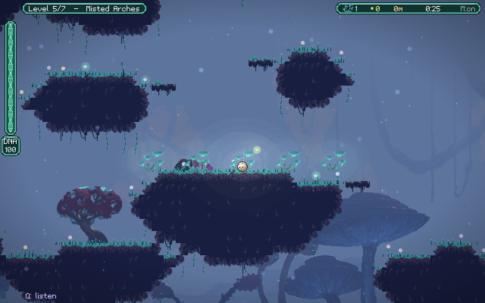
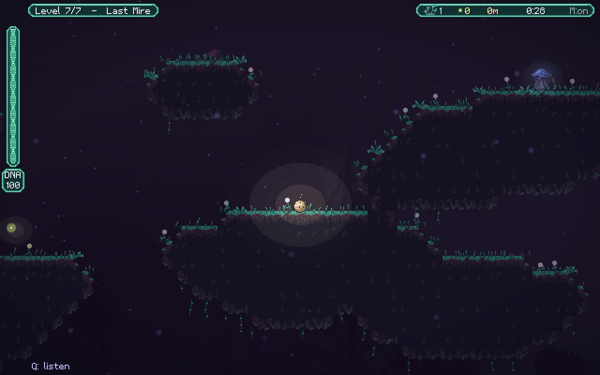

# Sporebound

*every miss grows something*



You're Puff, a tiny spore working your way down through seven levels of a dark fungal world. Fling yourself from ledge to ledge, and when you miss (you will), a glowcap grows right where you fell. Bounce off it and try again.

Made solo for Hack Club's **Harvest** jam, theme *Bounce Back!*

**Play it on itch.io:** *(link coming soon)*

## How to play

Drag back and let go to fling. You get one more fling in mid-air, so a bad jump isn't the end. If you do fall, look for the glowcap you just grew.

| Key | Does |
| --- | --- |
| Drag + release | Fling (works in mid-air too) |
| A / D | Roll |
| Space | Hop |
| Click / E | Blast toxin at rivals |
| Q | Ask the hooded one which way to go |
| R | Restart from your last safe spot |
| Esc | Pause (settings, fullscreen, effects) |
| M | Mute |

It works on phones too, with on-screen buttons.

## What's in it

- **7 levels**, each hiding an artifact, getting darker and harder the deeper you go
- **Glowcaps** that grow wherever you fall. Grow enough on a level and the cave starts lighting back up around you, and the music opens up with it
- **Rebound**: bounce off one of your own glowcaps and time slows, you leave afterimages behind and nothing can touch you for a few seconds (a little Edgerunners nod)
- **The Elder**, a huge thing that finds you on level 1 and starts hunting you from level 4
- **Mutations**: dying can mutate you, so a bad fall can leave you stronger
- **A garden** at the end, grown from every fall in your run
- An original soundtrack and sound effects



| | |
| --- | --- |
|  |  |

## How it's made

No engine and no libraries, just plain JavaScript drawing to a 640×400 canvas that gets scaled up to fit your screen.

| File | What's in it |
| --- | --- |
| `src/sim.js` | Puff's physics and collisions |
| `src/gen.js` | Level generation |
| `src/combat.js` | Rivals, the Elder and toxin |
| `src/vfx.js`, `src/pixelkit.js` | Particles, lighting and sprite helpers |
| `src/game.js` | Everything else: input, audio, HUD, menus |

The levels are generated, so to make sure none of them are impossible, `tools/levelcheck.js` runs the real physics and searches for a route through every level. `tools/placecheck.js` checks nothing is floating, buried or overlapping. Both run with Node:

```
node tools/levelcheck.js
node tools/placecheck.js
```

## Running it locally

You'll need your own copy of the swamp pack (see below for why):

1. Grab *Fantasy Swamp Forest* from [The Flavare's itch page](https://theflavare.itch.io/forest-nature-fantasy-tileset).
2. Drop `Terrain_and_Props.png`, `BG_1.png`, `BG_2.png`, `BG_3.png` and `BG_3_alt.png` into `assets/world/`.
3. Start any local server in the folder (`python3 -m http.server` works) and open `index.html`.

Heads up: it'll use the pack's original colours, not the recoloured ones from the itch build.

## Art & credits

Most of what you see in Sporebound is mine: Puff, the Elder, most of the enemies, the glowcaps and plants, a lot of the effects, plus the soundtrack and all the sound effects.

Two things came from asset packs:

| What | Pack | By |
| --- | --- | --- |
| Swamp tiles and backgrounds | [Fantasy Swamp Forest](https://theflavare.itch.io/forest-nature-fantasy-tileset) | [The Flavare](https://theflavare.com/) |
| Some effect sprites (dust, splashes, pops) | [Super Pixel Effects Gigapack](https://untiedgames.itch.io/super-pixel-effects-megapack-1) | unTied Games |

The swamp pack's license doesn't allow redistributing it, even edited, so `assets/world/` isn't in this repo. The itch.io build has everything, so that's the best way to play.

## License

The code is MIT (see [LICENSE](LICENSE)). The art, music and sound effects aren't, see [assets/LICENSE.md](assets/LICENSE.md).

made by harry
